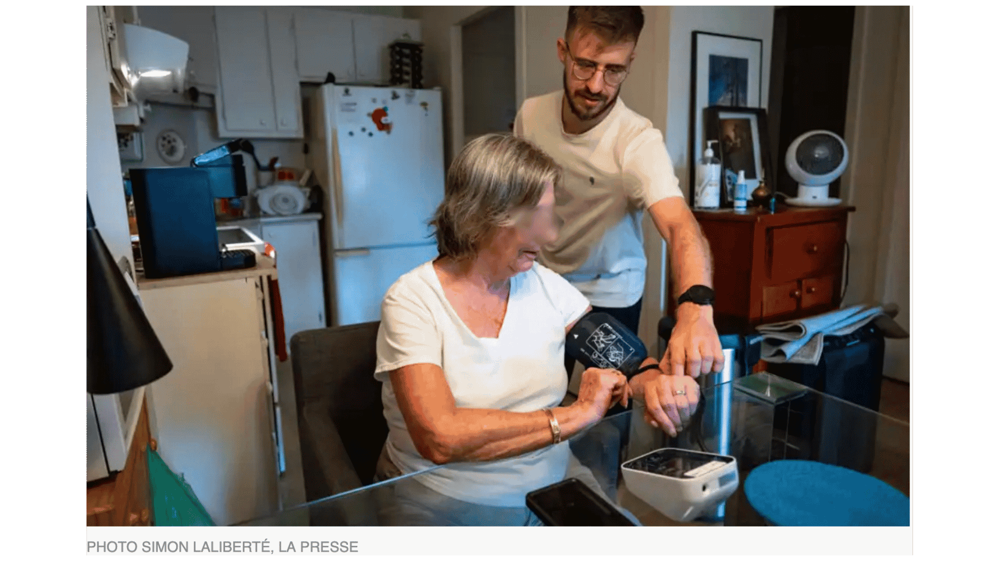

C’est une journée nuageuse et plus fraîche que prévu. Environ 26 °C à l’extérieur. Dans l’appartement de Lise Pellerin, pourtant climatisé, le thermomètre affiche 25 °C. L’air est lourd. « J’ai tout le temps chaud ! », lance-t-elle, assise dans son petit appartement devenu, le temps d’un été, un laboratoire sur la chaleur.

Mais à partir de quand la température à l'intérieur d'un logement devient-elle réellement problématique pour la santé?  [Voir plus ici](https://www.lapresse.ca/actualites/sante/2026-08-01/montreal/des-logements-sociaux-transformes-en-petits-laboratoires-sur-la-chaleur.php)

Article écrit par Valérie Simard (La Presse, journaliste) et Simon Laliberté (photographe)

{fig-align="center" fig-alt="Apercu de l'article de vulgarisation"}

