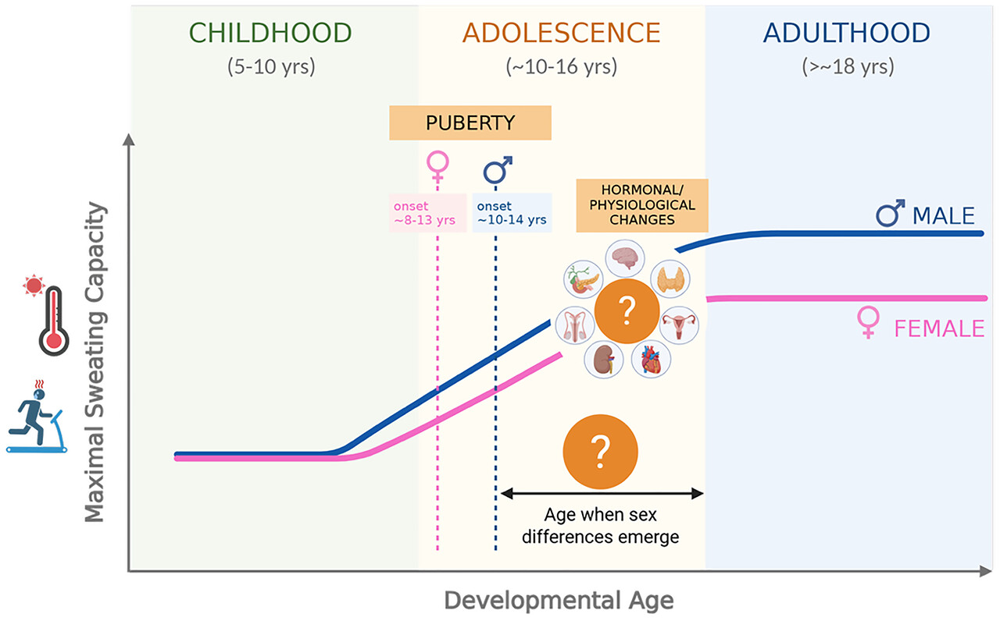

## Objective
This article reviews Topham et al. (2026), which asked whether children really sweat less than adults and whether biological sex matters before adulthood. The authors use the findings to examine a long-held belief, that children are more vulnerable to heat because their sweating capacity is lower. In this journal club, we suggested some evidence or research directions to see whether puberty might shape the sex differences in sweating seen in adults.

{fig-alt=""}
